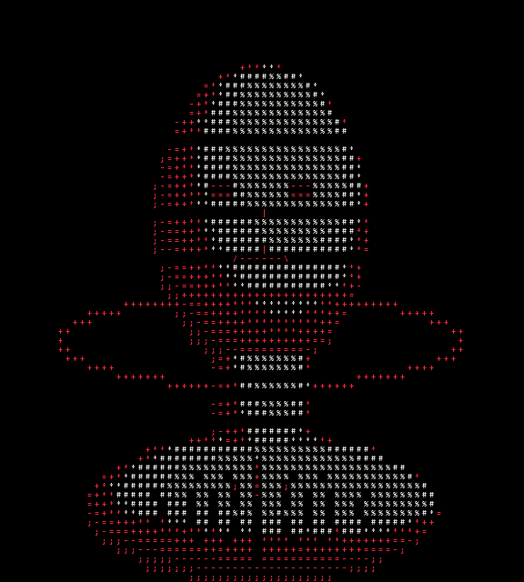

  <pre>
+----------------------------------------------------------------+
|  ILHAM / MAULANA-99        SOFTWARE DEVELOPER / INDONESIA        |
|  build / break / learn / repeat                                 |
+----------------------------------------------------------------+
  </pre>

<table>
  <tr>
    <td width="64%" valign="middle">
      <h2>Curiosity into working software.</h2>
      
I learn by building systems, apps, and tools—and staying with the hard parts until they work.

      

    </td>
    <td width="36%" align="center" valign="middle">
      
    </td>
  </tr>
</table>

---

### `./current-build`

A self-hosted code forge in Go: private repositories, a custom version-control engine, and a browser for files and history.

### `./toolkit`

`GO` · `NODE.JS` · `FLUTTER` · `POSTGRESQL` · `DOCKER`

### `./learning`

Backend architecture · application security · building tools that stay useful.

<code>END OF TRANSMISSION</code> <strong>///</strong>

