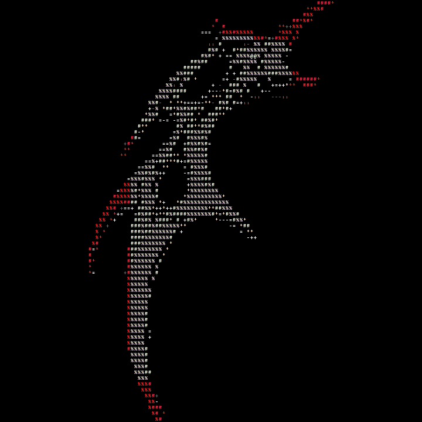

<pre>
┌────────────────────────────────────────────────────────────────────┐
│  I L H A M  /  MAULANA-99                   SOFTWARE DEVELOPER      │
│  BUILD  /  BREAK  /  LEARN  /  REPEAT          INDONESIA · ID       │
└────────────────────────────────────────────────────────────────────┘
</pre>

<h1>Curiosity into working software.</h1>

I build systems, apps, and tools—and stick with the hard parts until they work.

  

 
ASCII MOTION STUDY&nbsp; / &nbsp;CYBERSIGIL&nbsp; / &nbsp;FULL-TURN LOOP

<table>
  <tr>
    <td width="34%" valign="top">
      <strong><code>01 / BUILDING</code></strong>  
      A self-hosted code forge with private repositories and its own version-control engine.
    </td>
    <td width="33%" valign="top">
      <strong><code>02 / TOOLKIT</code></strong>  
      <code>GO</code> · <code>NODE.JS</code> · <code>FLUTTER</code> 
      <code>POSTGRESQL</code> · <code>DOCKER</code>
    </td>
    <td width="33%" valign="top">
      <strong><code>03 / LEARNING</code></strong>  
      Backend architecture Application security Building useful tools
    </td>
  </tr>
</table>

<pre>
[ curiosity ] ───► [ experiments ] ───► [ working software ]
</pre>

